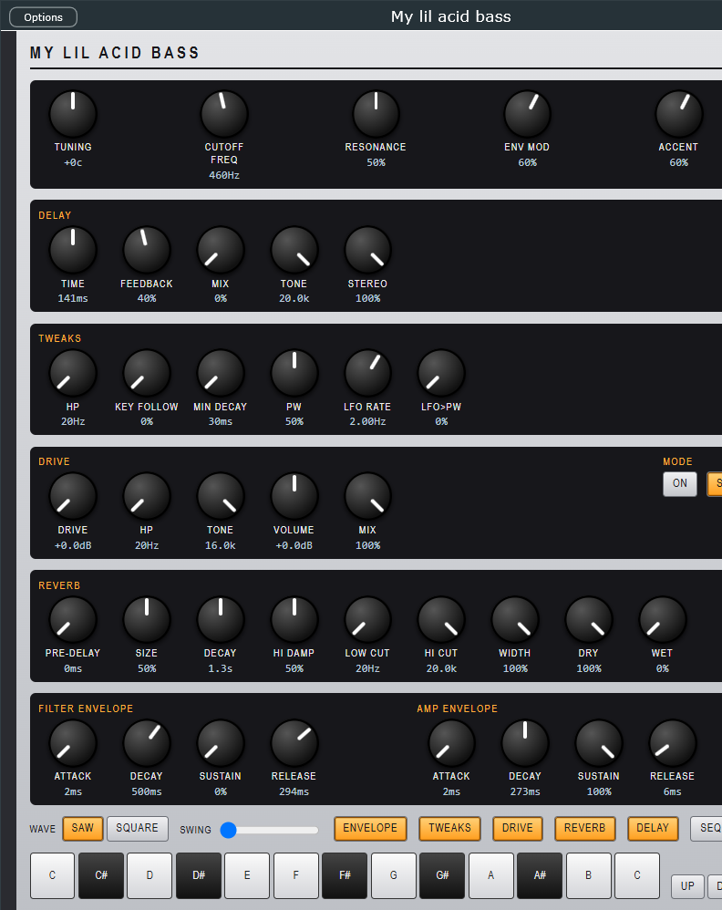

# My lil acid bassline

**by A_Development**

A 303-style acid bass synth and 32-step sequencer that runs in your browser (one page, no install, no build, no dependencies), and **My lil acid bass**, the same synth as a VST3 and standalone for FL Studio and other hosts.

## Download the plugin



**[Latest release](https://github.com/Adev-io/my-lil-acid-bassline/releases/latest)**, Windows 10/11 64-bit. Unzip, then:

1. Copy the whole folder `My lil acid bass.vst3` to `C:\Program Files\Common Files\VST3\` (needs admin).
2. FL Studio: **Options > Manage plugins > Find installed plugins**. Add **My lil acid bass** as an instrument. Other hosts: rescan.
3. Play it from the piano roll, or turn its sequencer on and press play.

Not code-signed: if SmartScreen warns, **More info > Run anyway**. The window needs WebView2 (built into Windows 11). Details, build-from-source and licence: [plugin/README.md](plugin/README.md).

## Use it

- **Online:** https://adev-io.github.io/my-lil-acid-bassline/
- **Locally:** open `index.html` in a browser (Chrome, Edge, Firefox). Audio starts on your first click or key press.
- **Classic:** the original, simpler version (one decay envelope, no delay) is kept in [`classic/`](classic/): https://adev-io.github.io/my-lil-acid-bassline/classic/

## What it does

**Sound.** Saw or square oscillator into a resonant 24 dB lowpass, with Tuning, Cutoff, Resonance, Env Mod, Accent, Volume and Tempo (40-300 BPM). Accent boosts level, shortens the filter decay and builds on stacked accents. Slide glides pitch without retriggering.

**Play.** The on-screen keys, or `Z S X D C V G B H N J M ,` on your keyboard. Up / Down shift the octave, Accent and Slide apply to the notes you play. Space runs and stops.

**Sequence.** 32 patterns (2 banks x A/B x 8), up to 32 steps each. Click a step, press a key to write a note (Write stays on), press **Rest** to remove it, **Tie** to hold the previous note. Under each step: octave, accent, slide. **Track** mode chains patterns into a song. **Load demo set** fills six starter lines and a sound to hear them in.

**Envelope** (press **Envelope**):

- **Filter envelope:** Attack, Decay, Sustain, Release. Env Mod is the depth; Sustain is a fraction of that depth held while the gate is up; Release returns the filter to the cutoff.
- **Amp envelope:** Attack, Decay, Sustain, Release for the volume shape. Short decay and sustain 0 gives plucks; long attack and release gives pads.
- **Gate length:** how much of each step the note is held, 10-100% (55% matches the original 303). It also sets the note lengths in the exported MIDI.
- **Live view:** both envelope shapes are drawn from the current knob values. Accent still shortens the filter decay.

**Tweaks** (press **Tweaks**):

- **HP:** a high-pass ahead of the filter, 20-500 Hz (20 is off). **Key Follow:** how much the cutoff rises with the note pitch, 0-100%.
- **Min Decay:** a floor under the filter and amp decay, 30 ms to 0.6 s. Accent decay is floored too.
- **PW:** pulse width, 5-95% (50% is a square). **LFO Rate** (0.05-20 Hz) and **LFO>PW** (0-100%) sweep the pulse width.

**Drive** (press **Drive**, LED on/off):

- **Drive:** pre-gain, 0-30 dB, with the level pulled back so full drive stays close to bypass volume. **Type:** soft, tube (asymmetric, more even harmonics) or wavefold.
- **HP** (20-800 Hz) before the stage, **Tone** (0.8-16 kHz lowpass after it), **Volume** (plus or minus 12 dB) and **Mix** (0-100%, dry to driven).

**Reverb** (press **Reverb**, LED on/off):

- A generated stereo room, not a sample. **Pre-delay** (0-200 ms), **Size**, **Decay**, **Hi Damp** (how fast the tail darkens), **Low Cut** and **Hi Cut** shape it, **Width** sets the stereo spread (0 is mono).
- **Dry** and **Wet** (0% by default, so the reverb is silent until you raise Wet). Size, Decay and Hi Damp rebuild the room with a short crossfade, so changes do not click.

**Delay** (press **Delay**):

- **Time** in milliseconds (20-1000, a knob or type the exact value in the ms box), **Feedback** (how many repeats), **Mix** (dry to wet; 0 is fully bypassed, which is the default).
- **Sync** snaps Time to note divisions of the tempo: 1/32, 1/16T, 1/16, 1/8T, 1/16., 1/8, 1/4T, 1/8., 1/4, 1/2T, 1/4., 1/2 (T = triplet, . = dotted). The echo follows the Tempo knob, automated or not, and flipping Sync keeps the echo where it was.
- **Ping-pong** makes repeats alternate left and right every Time; off, the repeats stay centred.
- **Fat** darkens each repeat, saturates it and wobbles the time slightly, for thick, tape-like echoes. The saturation never adds gain, so repeats still die away even at maximum feedback.
- **Tone** is a lowpass on the repeats (the first echo is not filtered), so turning it down makes the tail duller. **Stereo** sets the ping-pong width: 0 is centred, 100% is hard left and right.

**Automate.** Press **Automate** to show min %, max %, `~` and beats-per-sweep under every knob, including the envelope and delay knobs. With `~` on, the knob sweeps between your min and max in time with the tempo.

**MIDI in** (press **MIDI in**, Chrome or Edge): play the synth from a MIDI keyboard, or from FL Studio through a virtual MIDI cable such as [loopMIDI](https://www.tobias-erichsen.de/software/loopmidi.html). Notes play the voice and, while **Write** is on, record into the selected step; velocity 110 or more is an accent; the Slide and Up/Down buttons apply as they do for the on-screen keys. Controllers: CC74 cutoff, CC71 resonance, CC7 volume. The audio still plays from the browser, so to hear it inside FL you need a virtual audio cable too: for a proper FL instrument use the plugin (Download above).

**Export.** **Export folder** downloads `303-patterns.zip`: one `.txt` (step notation, tempo, knob settings) and one `.mid` per pattern, plus `song.txt` / `song.mid` for the song chain. In the MIDI, accents are loud notes, slides overlap the next note, and ties hold one note.

Step notation, one token per step: `C`..`B` note, `C'` high C, `^` `_` octave up/down, `*` accent, `~` slide, `-` rest, `=` tie. Example: `A* - A A^ - A_* A - G~ A - A* - C^ - E~`.

Your patterns and knob settings are saved in your browser, under their own key, separate from the classic version's.

## FL Studio plugin

[`plugin/`](plugin/) is the native version, built on JUCE: the voice, tweaks, drive, delay, reverb and envelopes, the 32-step sequencer on the host clock, a 128-slot pattern bank, MIDI drag-out, and the web page as its window. Download above; see [plugin/README.md](plugin/README.md) for the feature table and how to build it.

## Develop

```
bun test                           # or: node --test
```

`index.html` is the audio and UI; `acidbass.js` is the pure half (sequencer rules, state cleaning, automation, MIDI and zip writers), tested without a browser in `acidbass.test.mjs`. `classic/` has the same split.

## License

The web app (`index.html`, `acidbass.js`, `classic/`) is **MIT**. Copyright (c) 2026 Ari Klopfer / A_Development. See [LICENSE](LICENSE).

The native plugin in `plugin/` is **AGPL-3.0-or-later**, because it links the JUCE framework under JUCE's open-source AGPLv3 option. See [plugin/LICENSE](plugin/LICENSE).

The plugin binary embeds the MIT web files (`index.html`, `acidbass.js`, `factory.js`, `ui-bridge.js`) as its window. MIT code inside an AGPL binary is permitted; the combined work is AGPL-3.0-or-later.
